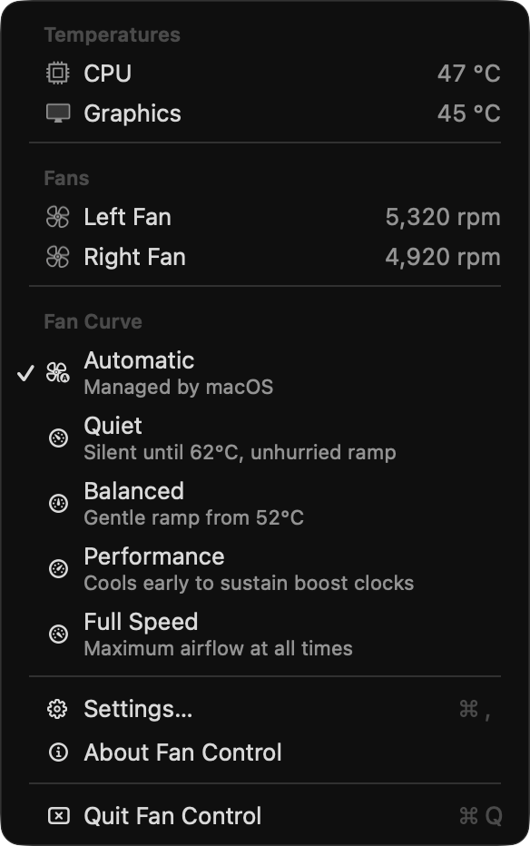
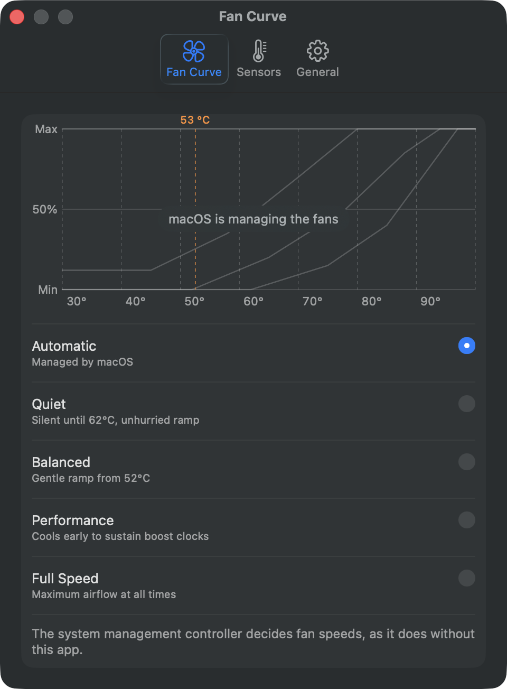

# Fan Control

A native macOS menu bar app for choosing how your Intel Mac's fans respond to heat. Pick a fan curve from the menu bar, from near-silent to full blast, and see live temperatures and fan speeds at a glance.

<p>
  
  &nbsp;
  
</p>

| Curve | Behavior |
| --- | --- |
| **Automatic** | macOS manages the fans, as it does without this app. |
| **Quiet** | Minimum speed until 62 °C, then an unhurried ramp. Brief load spikes go unheard. |
| **Balanced** | A gentle ramp from 52 °C, with smoothing so the fans don't hunt up and down. |
| **Performance** | Ramps early and fast to keep the CPU cool enough to hold boost clocks. |
| **Full Speed** | Every fan at its maximum. |

## Requirements

- **An Intel Mac with fans.** Apple silicon (M1 and later) Macs control their fans differently, and this app doesn't support them.
- **macOS 14 Sonoma or later.**

In practice, that means:

| macOS | Intel Macs that can run it |
| --- | --- |
| 26 | MacBook Pro 16" (2019), MacBook Pro 13" (2020, four Thunderbolt ports), iMac 27" (2020), Mac Pro (2019) |
| 15 Sequoia | The above, plus MacBook Pro (2018 and later), MacBook Air (2020), iMac (2019), iMac Pro, Mac mini (2018) |
| 14 Sonoma | The above, plus MacBook Air (2018–2019) |

It has been tested on a 16-inch MacBook Pro (2019). MacBook Pro and MacBook Air models use the same fan controls and should work the same way. iMac, Mac mini and especially Mac Pro are untested. If the app can't read a temperature on your Mac, it runs the fans at full speed rather than guessing.

Don't run Fan Control at the same time as another app that sets fan speeds, such as Macs Fan Control. The two will fight over the fans.

## Installing

### Download

1. Download **Fan-Control.zip** from the [latest release](https://github.com/Kombuchelada/fan-control/releases/latest).
2. Open the zip, then drag **Fan Control** into your **Applications** folder.
3. Open Fan Control from Applications.

Fan Control isn't notarized by Apple, so macOS blocks it the first time with a message that it can't verify the app. To allow it:

- **macOS 15 or later:** click **Done** in the warning. Then open **System Settings → Privacy & Security**, scroll down to the message about Fan Control, click **Open Anyway** and confirm.
- **macOS 14:** Control-click the app in Applications, choose **Open**, then click **Open** again.

You only need to do this once. If you'd rather use Terminal, this removes the download flag and opens the app:

```sh
xattr -dr com.apple.quarantine "/Applications/Fan Control.app"
open "/Applications/Fan Control.app"
```

### Build from source

You need the Xcode Command Line Tools; the full Xcode app isn't required. Apps you build yourself aren't blocked by Gatekeeper.

1. Install the Command Line Tools, if you don't have them:

   ```sh
   xcode-select --install
   ```

2. Clone the repository, then build and install the app:

   ```sh
   git clone https://github.com/Kombuchelada/fan-control.git
   cd fan-control
   scripts/build.sh --install
   ```

   This builds `Fan Control.app`, copies it to `/Applications` and opens it. A fan icon appears in the menu bar.

To build without installing, run `scripts/build.sh`. The app is written to `build/Fan Control.app`.

## Using it

**Choose a fan curve.** Click the fan icon in the menu bar and pick a curve. The first time you choose anything other than Automatic, macOS asks for an administrator password. Fan Control needs it to install a small helper that sets fan speeds (see [How it works](#how-it-works)). After that, switching curves is instant.

While a curve is active, the menu bar icon is filled in. Choose **Automatic** to hand the fans back to macOS.

**Check temperatures.** The menu shows the CPU and graphics temperatures and each fan's speed, updated every second while the menu is open.

**Settings** (menu → **Settings…**, or ⌘, while the menu is open) has three tabs:

- **Fan Curve:** a chart of every curve, with the current temperature and fan speed marked, and an explanation of the selected curve.
- **Sensors:** live readings, including each fan's minimum and maximum speed.
- **General:**
  - **Show temperature in menu bar** puts the current temperature next to the fan icon.
  - **Open at login** starts Fan Control when you log in. Your last curve is restored automatically.
  - **Uninstall…** removes the helper.

**Quitting** Fan Control returns the fans to automatic control.

## Safety

- Above 90 °C every curve ramps toward full speed, reaching it at 97 °C, whatever the chosen curve says.
- Fans go back to automatic control when the app quits or crashes, when the helper is stopped, and at every boot.
- If no temperature can be read, the helper runs the fans at full speed.
- Target speeds are always clamped to each fan's own minimum and maximum.

## Uninstalling

1. Open **Settings… → General** and click **Uninstall…** next to **Fan control helper**.
2. Quit Fan Control and delete it from `/Applications`.

If you've already deleted the app, remove the helper from Terminal:

```sh
sudo launchctl bootout system/app.fancontrol.helper
sudo rm /Library/PrivilegedHelperTools/app.fancontrol.helper /Library/LaunchDaemons/app.fancontrol.helper.plist
```

## How it works

Fan speeds and temperatures live in the Mac's System Management Controller (SMC). Anyone can read them, but only root can change them, so the project has four parts:

- **`FanControl`**: the menu bar app (AppKit `NSStatusItem` and `NSMenu`; SwiftUI and Swift Charts for Settings). It reads sensors directly from the SMC.
- **`FanControlHelper`**: a small root LaunchDaemon (`app.fancontrol.helper`). It runs the control loop once a second, and it accepts XPC connections only from a client signed as `app.fancontrol.FanControl`. The app installs it with the standard macOS administrator prompt.
- **`FanKit`**: shared code: SMC access, sensors, the curve definitions and the curve controller.
- **`fanctl`**: a diagnostic command line tool: `fanctl status`, `fanctl keys [prefix]`, `sudo fanctl set <fan> <rpm>` and `sudo fanctl auto`.

Each curve maps temperature to a fraction of a fan's own speed range. The input is the hotter of the CPU and GPU die temperatures. Each curve also sets how quickly the fans respond:

- **Smoothing:** temperature changes are averaged over time, so brief spikes don't make the fans surge.
- **Hysteresis:** temperatures must fall a few degrees before the fans slow down.
- **Rate limits:** how fast the fans may speed up or slow down.

The curves are defined in [`Sources/FanKit/FanProfile.swift`](Sources/FanKit/FanProfile.swift).

## Development

```sh
scripts/build.sh                # build build/Fan Control.app (ad-hoc signed)
scripts/package.sh              # build and zip it for a GitHub release
scripts/test.sh                 # unit tests for the curves and the controller
swift scripts/make-icon.swift   # regenerate Resources/AppIcon.icns
```

- If you change the helper, bump `HelperConstants.helperVersion` so the app reinstalls it.
- Debug builds can save their own menu and Settings window as PNGs, which is handy for checking layout without screen-recording permission. Run the debug binary from inside an app bundle with `FANCONTROL_SNAPSHOT=/some/dir`.

## License

Released into the public domain under [the Unlicense](LICENSE). Use it for anything, with or without credit.
